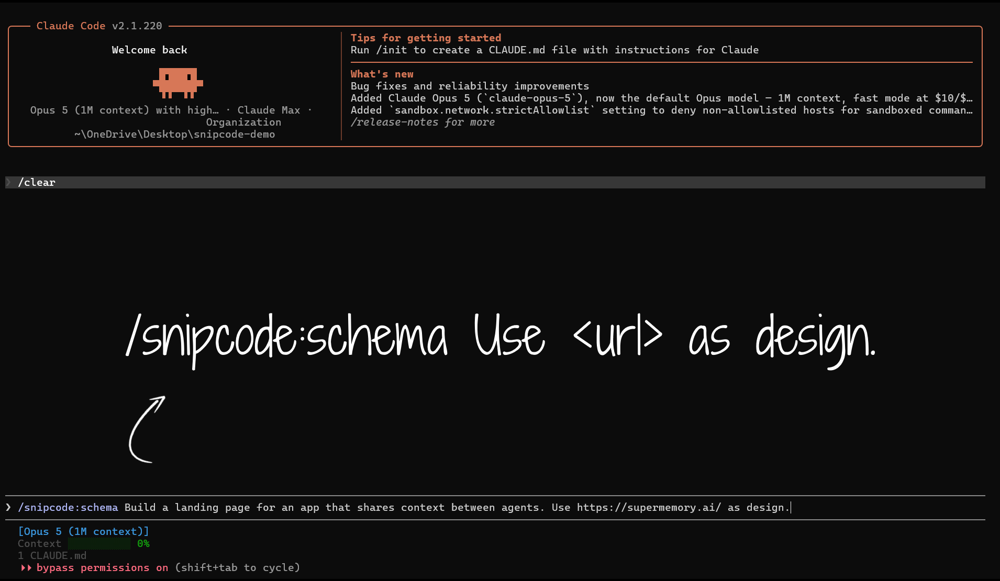
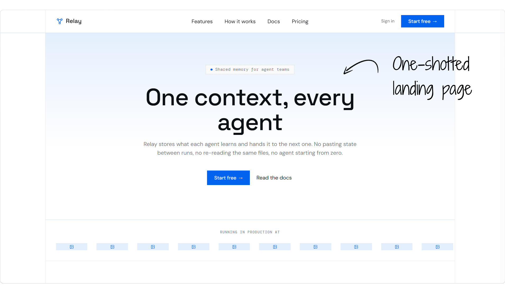

<p align="center">
  <picture>
    <source media="(prefers-color-scheme: dark)" srcset="assets/banner-dark.png">
    
  </picture>
</p>

<p align="center">
  <em>Your agent just got scissors.</em>
</p>

<br>

<p align="center">
  
  
  
  
</p>

<br>

<p align="center">
  
  
</p>

<br>

## What It Does

SnipCode extracts designs and components from any live web page. It gives your agent two
capabilities:

1. **Extract a design.** Get a page's design tokens (colors, typography, spacing, border radii,
   shadows) and a layout blueprint.

2. **Extract a component.** Get any element as self-contained code: markup plus a single
   stylesheet, with fonts and images inlined. Supports HTML, JSX, Tailwind, and Vue.

SnipCode uses the browser's computed styles, not the source CSS, so the output matches what
renders on screen. It makes no LLM calls, leaving every decision to your agent.

Check out the [Chrome extension](https://github.com/micahtid/snip-code) too.

<br>

## Installing

Install the plugin in Claude Code:

```
/plugin marketplace add micahtid/snipcode-plugin
/plugin install snipcode@snipcode
```

Then install the CLI and Chromium:

```bash
npm install -g snipcode           # Optional: the skill falls back to npx
npx playwright install chromium
```

<br>

## Using It

Describe what you want, for example:

> Make this landing page look like linear.app.

> Snip the pricing card off stripe.com/pricing as Tailwind.

Your agent picks the element and runs the CLI:

```bash
snipcode schema https://linear.app
snipcode candidates https://stripe.com/pricing
snipcode extract https://stripe.com/pricing --selector ".PricingCard" --format tailwind
```

<br>

## Commands

Every command writes one JSON object to stdout, including errors (`{ error: { code, message } }`
with a nonzero exit code). Files go to `--out` (default: `./snipcode-out`).

| Command | Description | Output |
| --- | --- | --- |
| `schema <url>` | Returns design tokens and page layout. | `schema.json`, `schema.md` |
| `candidates <url>` | Lists targetable elements, each with a stable selector, text content, and bounding box. | Full-page screenshot |
| `extract <url> --selector "<css>"` | Extracts one element. Set the format with `--format html\|jsx\|tailwind\|vue`. | Markup and stylesheet |

Site builders like Framer and Wix don't expose their styling in the DOM, so SnipCode returns a
screenshot crop for your agent to rebuild visually.

<br>

## How The Code Is Organized

```
core/            In-page extraction pipeline, bundled as a single injectable IIFE
runner/          Node host: Playwright Chromium, navigation, waits, and script injection
cli/             Argument parsing, command dispatch, schema.md rendering, and file output
instructions/    Agent-facing guidance, shared by the skill, --help, and JSON output
skill/           Claude Code plugin: skill files and .claude-plugin/plugin.json
.claude-plugin/  Marketplace manifest (marketplace.json), pointing at skill/
test/            End-to-end, unit, golden snapshot, and fidelity tests
```

<br>

## Developing

```bash
npm install
npx playwright install chromium
npm run verify          # Runs the full check: typecheck, build, unit, end-to-end, golden, fidelity
```

CI runs `npm run verify`. Each step also runs on its own:

```bash
npm run typecheck       # Typechecks core (browser) and runner plus CLI (Node)
npm run build           # Builds the core IIFE and the Node CLI bundle
npm run gen:skill       # Regenerates the skill files and the plugin manifest
npm test                # Builds, then runs unit, end-to-end, golden, and fidelity tests
claude --plugin-dir ./skill  # Loads the plugin locally for testing
```

Contributions are welcome. See [CONTRIBUTING.md](./CONTRIBUTING.md) for project conventions,
report bugs or request features in [issues](https://github.com/micahtid/snipcode-plugin/issues),
and report vulnerabilities privately through [SECURITY.md](./SECURITY.md).

<br>

## License

[MIT](./LICENSE)
